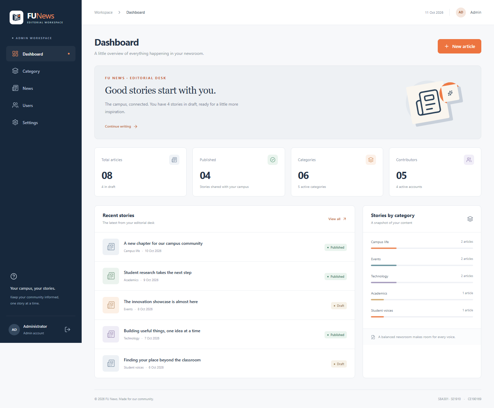

# FU News · Assignment 01

Frontend quản trị **FUNewsManagementSystem**, môn SBA301.

| Thông tin      | Giá trị              |
| -------------- | -------------------- |
| Sinh viên      | Lâm Thoại Thanh      |
| MSSV           | CE190169             |
| Lớp            | SE1910               |
| Project        | LamThoaiThanh_SE1910 |
| Phiên bản      | 1.0.0                |
| Đăng nhập demo | `Admin` / `Admin`    |



## Cài đặt và chạy

Dùng Node.js **22.12 trở lên** và npm. Bản đã kiểm tra trên Node 22.14.0, npm 10.9.2. Thư viện và phiên bản cụ thể nằm trong `package-lock.json`.

```sh
git clone https://github.com/thoaithanh-web/SBA.git
cd SBA/ass1/LamThoaiThanh_SE1910
npm ci
npm run dev
```

Mở URL Vite in trong terminal, thông thường `http://127.0.0.1:5173`. Dùng đúng origin để truy cập lại dữ liệu localStorage đã lưu. `localhost` và `127.0.0.1` có storage riêng.

```sh
npm run build
npm run preview
```

Trong IntelliJ IDEA, mở thư mục chứa `package.json`, chọn Node interpreter, chạy các lệnh trên trong Terminal hoặc tạo npm Run Configuration cho script `dev`.

## Chức năng

- Login có validation rỗng/sai credential, hiện/ẩn password, bảo vệ route và trở lại deep link sau login.
- Sidebar gồm Dashboard, Category, News, Users, Settings; responsive menu trên điện thoại.
- Dashboard tổng hợp số bài, bài Published/Draft, categories, contributors và các bài cập nhật gần nhất từ dữ liệu hiện tại.
- Category: xem/thêm/sửa/xóa, tìm theo tên, lọc Active/Inactive.
- News: xem danh sách và preview đầy đủ, thêm/sửa/xóa, tìm title/content, lọc category và Published/Draft; tags được trim và loại trùng.
- Users: xem/thêm/sửa/xóa, tìm username/name/email, role Admin=1/Staff=2 và status Active=1/Inactive=0.
- Create/Update bằng modal, Delete bằng confirmation; Cancel không ghi dữ liệu.
- Settings lưu tên publication/tagline và có xác nhận trước khi khôi phục demo data.
- Dữ liệu giữ qua refresh/logout bằng localStorage; session login giữ trong tab bằng sessionStorage.
- Validation, empty/no-result states, toast, xử lý storage hỏng/không lưu được, navigation bằng bàn phím và focus trong dialog.

## Quy tắc dữ liệu

- Category name và username phải duy nhất, không phân biệt hoa/thường sau khi trim.
- Article bắt buộc có title/content, category và author tồn tại. Status là 0 hoặc 1.
- Không xóa category hoặc author còn được bài viết tham chiếu; cần chuyển hoặc xóa bài trước.
- Tài khoản demo `Admin` không bị xóa, đổi username, tắt hoặc hạ role; có thể sửa tên/email.
- Category/author inactive vẫn tồn tại và có thể được chọn; UI ghi rõ `(inactive)`. Status dùng để quản lý, không tự xóa liên kết hoặc tạo một hệ thống phân quyền mới.
- Contributor records quản lý metadata; chỉ `Admin/Admin` cung cấp mock login theo đề. Không lưu password của contributor. Không nhập credential thật vào bản demo.
- Create mở form mới, Edit prefill đúng record. Create thành công xóa filters để thấy bản ghi mới; Edit giữ filters, vì vậy record có thể rời kết quả khi không còn khớp.
- News `createdAt` giữ nguyên khi sửa; `updatedAt` đổi khi lưu. Ngày hiển thị theo `Asia/Ho_Chi_Minh`.

## Cấu trúc

```text
src/
  components/    UI chung, modal form, confirmation, preview
  context/       AuthProvider, NewsProvider
  data/          seed data độc lập
  layouts/       AdminLayout: sidebar, header, Outlet, footer
  pages/         Login, Dashboard, Category, News, Users, Settings, NotFound
  services/      validation, immutable CRUD, persistence, search
  styles/        Bootstrap dashboard template và CSS ứng dụng
  utils/         date/initials formatting
  App.jsx        protected route composition
  main.jsx       React entry, BrowserRouter, Bootstrap CSS
tests/           browser tests với Playwright
docs/            architecture, requirements, test matrix, debug/AI log, demo guide
public/          logo tạo bằng AI
```

## Kiểm tra

```sh
npx playwright install chromium
npm run format:check
npm run build
npm test
```

`npm test` tự chạy Vite tại port 5173. Nếu có server khác chiếm port đó, dừng server trước. Mỗi browser test có storage riêng và dữ liệu ban đầu độc lập. Báo cáo HTML được tạo ở `playwright-report/`; traces/screenshots của lỗi ở `test-results/`, cả hai không commit.

```sh
npx playwright show-report
npm run test:ui
```

Ảnh minh chứng được chụp từ ứng dụng thật. Để tạo lại:

```powershell
$env:CAPTURE_EVIDENCE = '1'
npx playwright test workspace.spec.js --grep 'desktop and mobile'
Remove-Item Env:CAPTURE_EVIDENCE
```

## Nguồn template và logo

Layout dựa trên **Bootstrap 5 Dashboard example**, tách navbar/sidebar/content thành React components và tùy chỉnh CSS. `src/styles/template.css` lưu phần CSS mẫu đã bỏ comment; `app.css` chứa phần tùy chỉnh. Chưa có template riêng của giảng viên trong workspace; nếu lớp yêu cầu một template cụ thể khác, cần đối chiếu lại giao diện với tài nguyên đó.

- Template: https://getbootstrap.com/docs/5.3/examples/dashboard/
- CSS nguồn: https://getbootstrap.com/docs/5.3/examples/dashboard/dashboard.css
- React: https://react.dev/
- React Bootstrap: https://react-bootstrap.github.io/
- React Router: https://reactrouter.com/
- Vite: https://vite.dev/
- Playwright: https://playwright.dev/
- Logo: built-in ImageGen, prompt và asset path trong [AI_USAGE.md](docs/AI_USAGE.md).
- Attribution/license: [THIRD_PARTY_NOTICES.md](THIRD_PARTY_NOTICES.md).

## Hồ sơ đối chiếu bài

- [Requirements và bằng chứng](docs/REQUIREMENTS.md)
- [Thiết kế và state ownership](docs/ARCHITECTURE.md)
- [Test matrix](docs/TEST_MATRIX.md)
- [Debug log thực tế](docs/DEBUG_LOG.md)
- [AI usage log](docs/AI_USAGE.md)
- [Hướng dẫn demo và tự giải thích](docs/DEMO_GUIDE.md)

## Giới hạn và phần sinh viên cần làm

Ứng dụng là frontend mock, không có Spring Boot/database/authentication production. Không có API key hoặc backend secret. Session phía client có thể bị sửa bằng DevTools; localStorage không bảo đảm đồng bộ nhiều người hay nhiều tab, và mất khi xóa site data. Khi triển khai BrowserRouter lên hosting, server cần fallback deep links về `index.html`.

AI hỗ trợ đáng kể việc triển khai và kiểm thử. Tài liệu hướng dẫn môn yêu cầu sinh viên hiểu, kiểm chứng, chỉnh sửa và tự giải thích code; bản này không chứng minh thay việc đó. Trước khi nộp, sinh viên cần thực hiện phần tự kiểm chứng trong `DEMO_GUIDE.md`, ghi lại phần mình đã điều chỉnh trong `AI_USAGE.md`, và xác nhận quy định AI/template với lớp. Không ghi nhận các bước sinh viên chưa thực hiện là đã hoàn thành.
