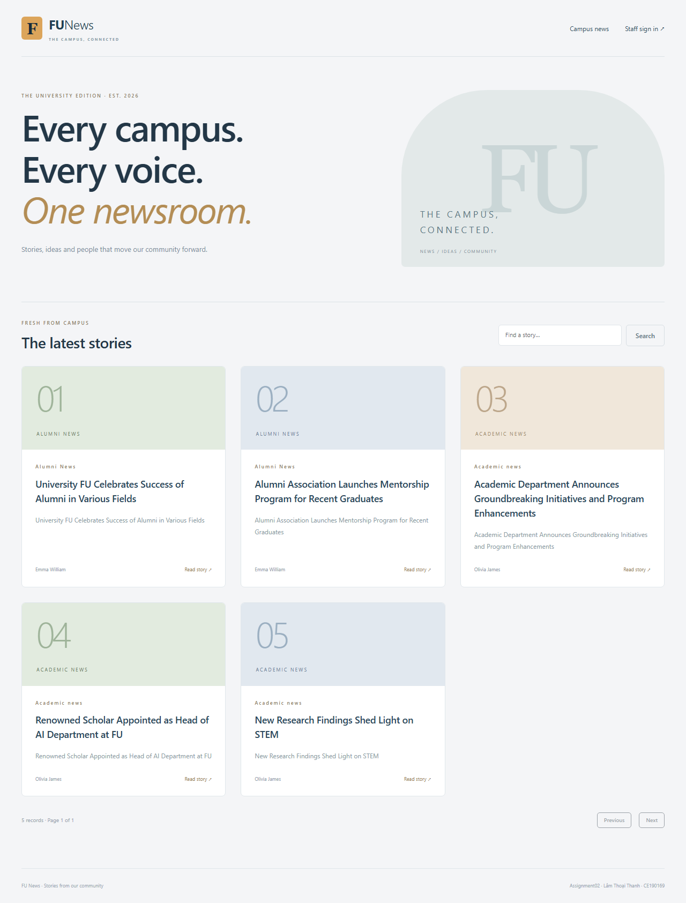
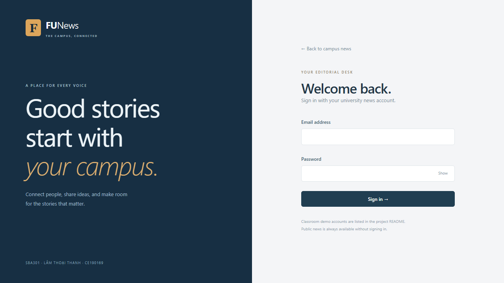
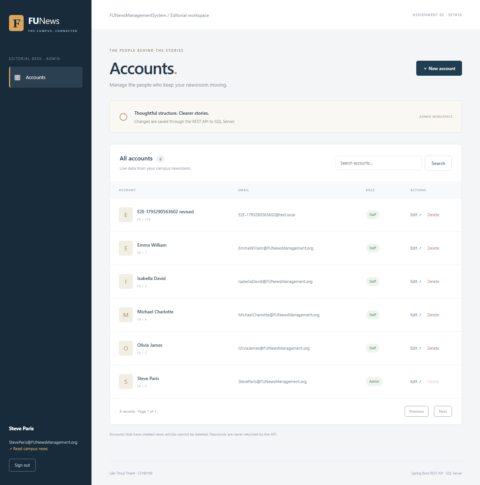
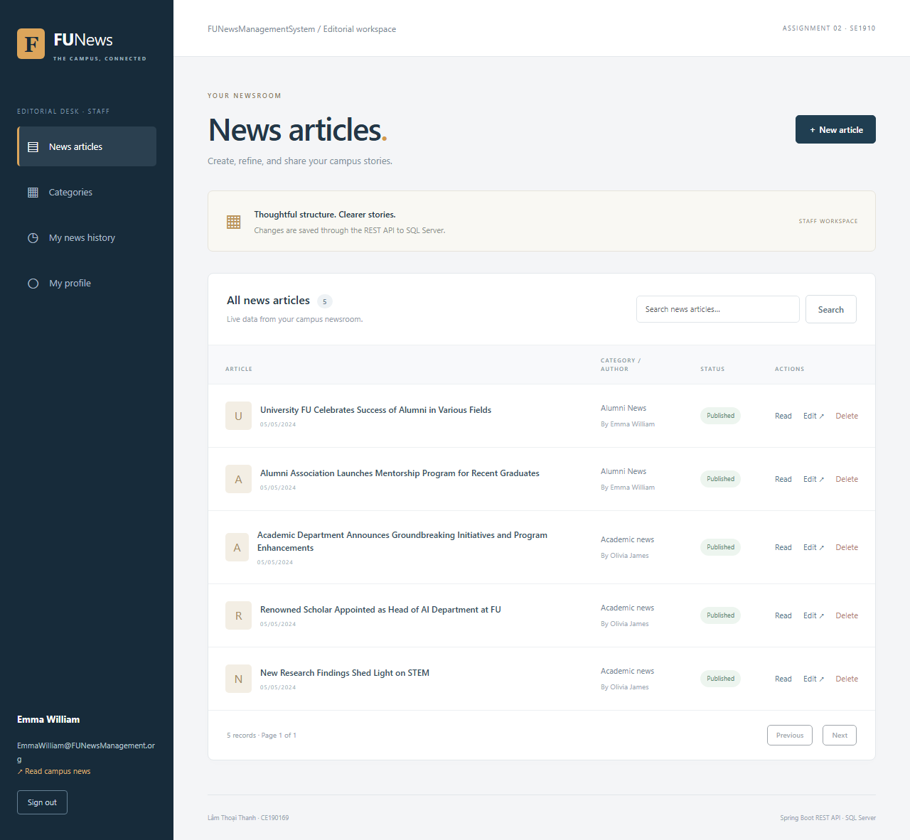
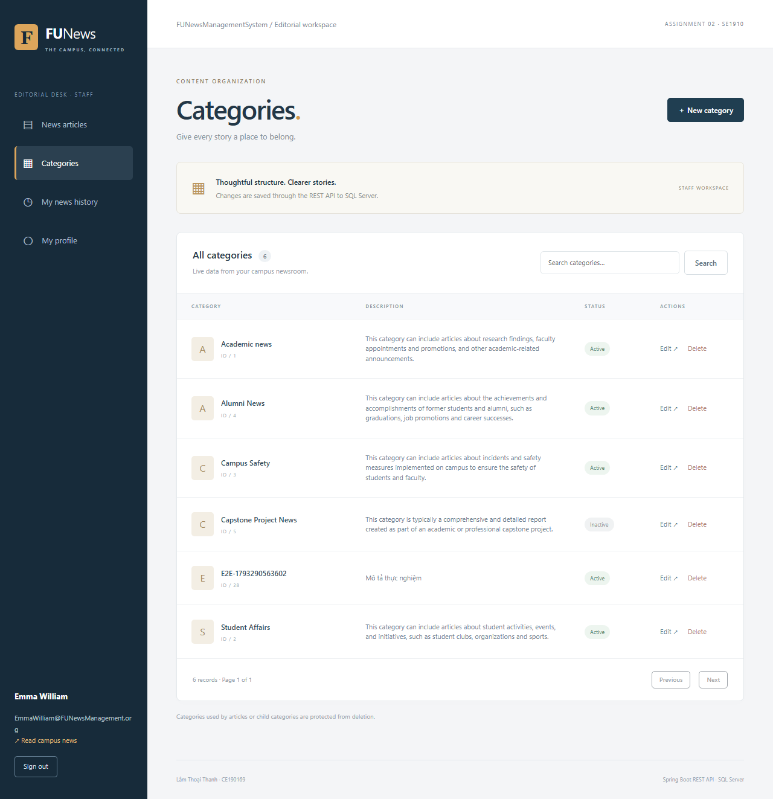
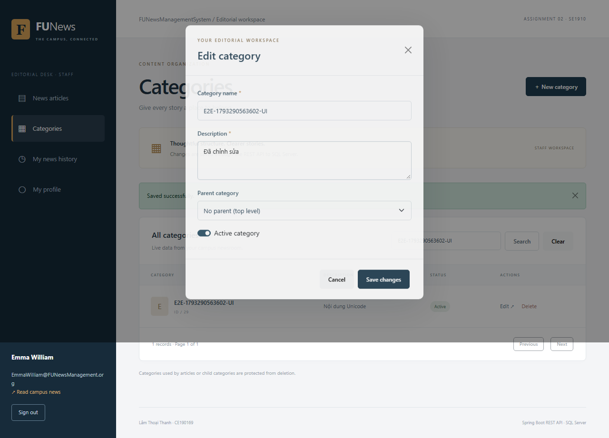
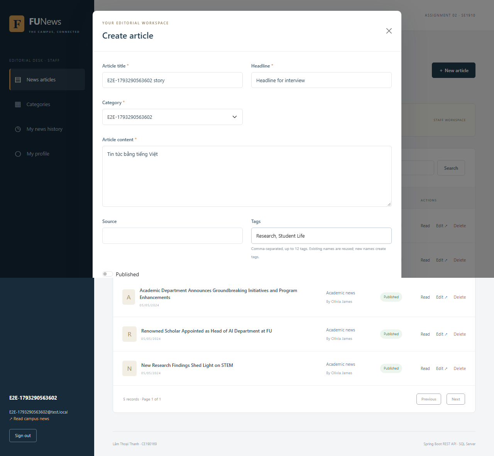
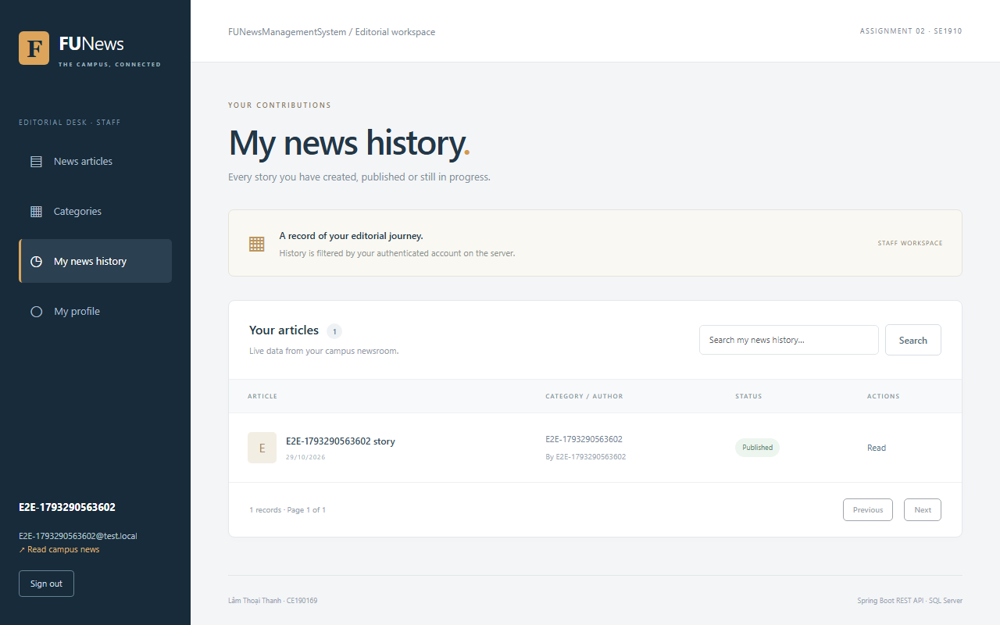
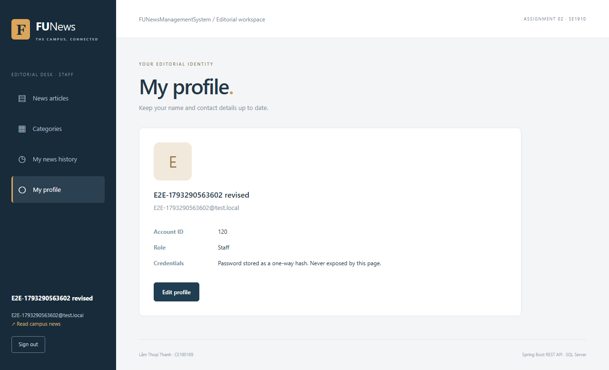
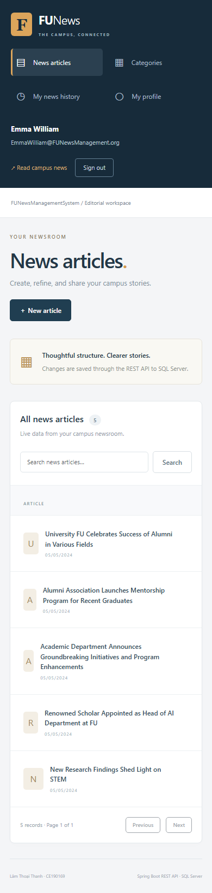

<!-- Author: Lam Thoai Thanh - CE190169 -->
# Kết quả kiểm thử Ass2

Kiểm tra ngày 29/10/2026 trên máy Windows, Java 21/Node 22, SQL Server 16 (2022), backend 8082/frontend 5174.

| Kiểm tra thực tế | Kết quả | Chứng minh |
| --- | --- | --- |
| Maven verify với SQLSERVER_TESTS=true | PASS:19 tests,0 failures,0 errors,0 skipped; JAR đóng gói thành công | 18 tests H2 +1 test SQL Server thật |
| API smoke qua HTTP/session thật | PASS 15 cases | [backend-smoke.json](evidence/backend-smoke.json) |
| Playwright Chromium gọi backend thật | PASS9/9 trong 26 giây | CRUDpopup/search/deleteconfirm, news/tags/publish/history/profile, roles/session, failure/retry/mobile |
| Prettier format:check | PASS | Source và test frontend |
| ESLint | PASS | Không có lỗi lint |
| Vite production build | PASS | Build JS/CSS tách bundle thành công |

[verification-summary.json](evidence/verification-summary.json) ghi số liệu từ báo cáo JUnit và kết quả local. Báo cáo đầy đủ nằm ở target/surefire-reports và playwright-report trên máy, không commit các thư mục sinh tự động. CI tạo lại báo cáo và lưu artifact 14 ngày. Kết quả CI xem trên GitHub Actions của commit nộp, không giả định CI đã qua từ kết quả local.

## Phạm vi

- Public chỉ active; private401 nếu chưa đăng nhập, sai role403, thiếuCSRF403.
- CRUD account/category/news; email/category trùng409, PUTkhôngtồntại404, dữ liệu rỗng400.
- Không xóa creator account/category có tin; không cho chu trình parent hoặc xóa parent cócon.
- Creator không giả bằng JSON, history lọc session, profile không đổi role/identity.
- Hash mật khẩu không bằng plaintext và BCrypt.matches đúng; response không có hash.
- Xóa NewsArticle dọn NewsTag nhưng giữ Tag. Search/page và sort allowlist; CORS preflight hợp lệ.
- SQLServerIntegrationTest xác minh DB_NAME, @@VERSION, NVARCHAR tiếng Việt, NewsTag và delete guard bằng API/JPA/JDBC trên SQL Server thật. Dữ liệu test rollback, sequence có thể tăng.
- Browser đi qua popup tạo/sửa/xóa account/category/news, Publish và public404→200→404, profile F5, history, logout/refresh, retry503 và viewport390px. Bảng trên điện thoại cuộn ngang bên trong panel.

## Lỗi phát hiện và đã sửa trong tiến trình

1. SQL filtered unique index cần QUOTED_IDENTIFIER ON; thêm SET đúng trước DDL và chạy lại seed không phá dữ liệu.
2. CORS phải truyền đúng CorsConfigurationSource vào SecurityFilterChain; thêm regression preflight.
3. URL role checks chặn trước Bean Validation, đồng thời giữ @PreAuthorize ở controller.
4. NewsResponse có cả categoryId/categoryName và newsArticleId/newsTitle. UI dùng chung từng chọn nhầm category khi tìm ID/tên bản tin; ưu tiên đúng newsArticleId/newsTitle. Test tạo/edit/publish/delete cùng một ID bảo vệ lỗi này.
5. Router chuyển public list sang detail từng giữ Page state cũ. Đặt key riêng cho hai màn hình để khởi tạo state đúng kiểu dữ liệu.
6. Windows khóa JAR đang chạy khi Maven repackage. Dừng đúng process Ass2 trước build; bản demo hiện chạy từ bản sao trong thư mục .runtime bị Git bỏ qua.

## Ảnh chạy thực tế

Các ảnh chụp trong kiểm thử, dữ liệu E2E là dữ liệu tạm được dọn sau khi chạy. Không có mật khẩu/session token trong ảnh.

### Public

### Login

### Admin

### Staff và popup

### Điện thoại

Các test/ảnh chứng minh hành vi đã chạy, không thay thế phần giải thích cá nhân trong interview hoặc bảo đảm điểm số.
