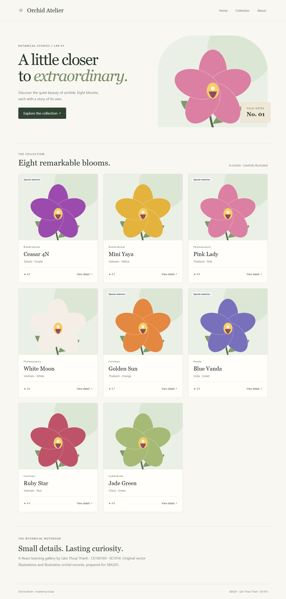

# Lab 01 · Orchid Atelier

Lâm Thoại Thanh · CE190169 · SE1910 · SBA301.

React/Vite gallery theo Integrated React Lab01, Slot05. Core gồm React-Bootstrap NavBar, grid, Card, ảnh local và component tái sử dụng. Props, state và modal detail là phần consolidation/bridge từ Lab02, không ghi thành yêu cầu gốc Lab01.



## Chạy

Node 22.12+ và npm. Mở riêng thư mục `lab01` trong IDE hoặc terminal:

```sh
npm ci
npm run dev
```

Dev: http://127.0.0.1:5171. Production preview:

```sh
npm run build
npm run preview
```

Preview: http://127.0.0.1:4171. Hai lab độc lập, không import mã nguồn qua thư mục lab khác.

## Kiểm thử

```sh
npx playwright install chromium
npm run format:check
npm run build
npm test
```

3 browser tests kiểm tra 8 cards/ảnh local, modal theo đúng record, đóng bằng button/Escape và mobile/navbar. Tests chạy trên production preview; screenshots trong `docs/evidence/`. Build và kiểm thử đã chạy ngày 12/10/2026; xem [test matrix](docs/test-matrix.md).

## Cấu trúc và luồng

`index.html → main.jsx → App → NavBar / OrchidList / Footer`.

`OrchidList` sở hữu selected orchid; lấy `OrchidsData`, map theo id → `OrchidCard`. Card phát `onDetail(orchid)` lên list; list cập nhật state → `OrchidDetailModal`. Đóng modal đặt selected về null. Không có HTTP, Router hoặc backend trong Lab01.

- `src/components`: UI, card, modal, navbar, footer.
- `src/shared`: dữ liệu baseline.
- `src/styles`: giao diện responsive.
- `public/images`: 8 SVG local, đường dẫn `/images/...`.


## Nguồn dữ liệu và giới hạn

Không có bộ ảnh/data gốc của lớp trong workspace. Tám records là dữ liệu minh họa, không được chứng nhận thông tin thực vật học. SVG được tạo riêng bằng mã vector, không lấy ảnh không rõ giấy phép. Có thể thay asset và records bằng resource chính thức khi giảng viên cung cấp.

Không có persistence, login hoặc API; refresh đưa UI về trạng thái ban đầu. Modal là bridge đã triển khai để thực hành state/event.

Xem [architecture](docs/architecture.md), [AI usage và phần sinh viên tự làm](docs/ai-usage.md). Phần vấn đáp, Human Gate và sửa bài trực tiếp của sinh viên chưa được đánh dấu hoàn thành.
