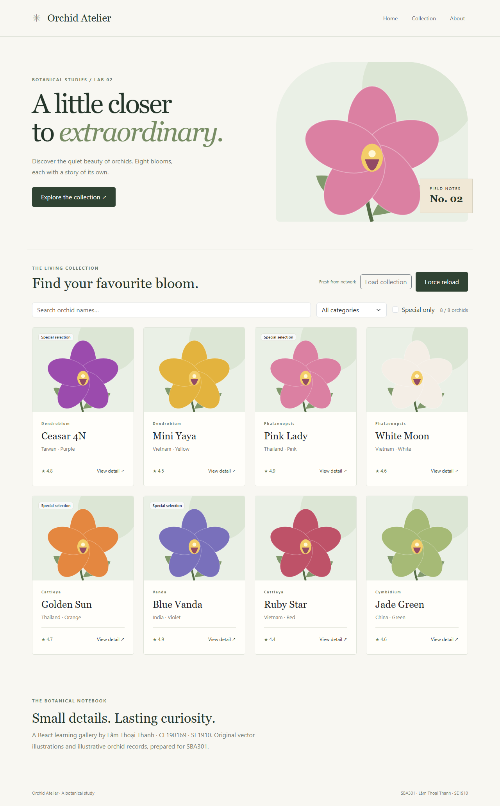

# Lab 02 · Orchid Atelier

Lâm Thoại Thanh · CE190169 · SE1910 · SBA301.

React/Vite Orchid Gallery theo Lab02 + Slot09: giữ NavBar/Card/Modal core, thêm service, Fetch, async state, cache TTL 30 giây và Force Reload. Search/category/special filters là extension local.



## Chạy

Node 22.12+ và npm. Mở riêng thư mục `lab02` trong IDE hoặc terminal:

```sh
npm ci
npm run dev
```

Dev: http://127.0.0.1:5172. Production preview:

```sh
npm run build
npm run preview
```

Preview: http://127.0.0.1:4172. Hai lab độc lập, không import mã nguồn qua thư mục lab khác.

## Kiểm thử

```sh
npx playwright install chromium
npm run format:check
npm run build
npm test
```

4 Node service tests và 8 browser tests: TTL boundary, force reload, clone cache, cancellation/race, loading, HTTP 404/retry, invalid JSON/structure, empty, filters không gọi HTTP, modal và mobile. Tests chạy trên production preview; screenshots trong `docs/evidence/`. Build và kiểm thử đã chạy ngày 12/10/2026; xem [test matrix](docs/test-matrix.md).

## Cấu trúc và luồng

`index.html → main.jsx → App → NavBar / Orchids / Footer`.

`Orchids → useOrchids → orchidService → apiClient → GET /orchids.json → hook state → cards`. Modal dùng selected orchid tại Orchids. `shared/ListOfOrchids.js` giữ static baseline để đối chiếu; app final đọc bằng Fetch, không import baseline vào UI.

- `src/components`: UI, card, modal, navbar, footer.
- `src/shared`: dữ liệu baseline.
- `src/styles`: giao diện responsive.
- `public/images`: 8 SVG local, đường dẫn `/images/...`.
- `src/api`: Fetch client, validation/cache service và Axios comparison.
- `src/hooks`: lifecycle/state/cancellation.
- `public/orchids.json`: nguồn JSON HTTP runtime.

## Nguồn dữ liệu và giới hạn

Không có bộ ảnh/data gốc của lớp trong workspace. Tám records là dữ liệu minh họa, không được chứng nhận thông tin thực vật học. SVG được tạo riêng bằng mã vector, không lấy ảnh không rõ giấy phép. Có thể thay asset và records bằng resource chính thức khi giảng viên cung cấp.

Cache nằm trong module JS, chỉ sống trong tab hiện tại, không persist và không phải HTTP cache. Load collection dùng cache nếu còn TTL; Force reload/Try again bỏ qua cache. `cache: no-store` giúp quan sát request thật. Hook abort request cũ/unmount; generation guard ngăn response cũ ghi đè cache mới. Axios comparison là ví dụ riêng, không được UI final sử dụng.

Xem [architecture](docs/architecture.md), [AI usage và phần sinh viên tự làm](docs/ai-usage.md). Phần vấn đáp, Human Gate và sửa bài trực tiếp của sinh viên chưa được đánh dấu hoàn thành.
