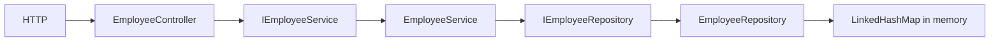

# Concept trace

POST JSON → Jackson bind Employee record → Bean Validation → controller gọi createEmployee → service kiểm tra/trim → repository synchronized kiểm tra duplicate rồi put → trả Employee → controller trả201+Location → Jackson JSON. Record immutable tránh client sửa reference làm thay đổi kho.

GET list → controller validate page/size/sort qua Paging.of → service → repository snapshot/sort với empId tie-break → lấy window → PageResponse gồm totals. Slice lấy window size+1 để quyết định hasNext; representation không có totalElements/totalPages. Dù vậy in-memory implementation vẫn sort toàn collection; không tuyên bố tối ưu SQL COUNT.

GET missing → repository Optional.empty → ResourceNotFoundException tại service → GlobalExceptionHandler trả404 với timestamp/status/message/path. V1 giữ bốn fields; V2 map representation thêm demo email/department. Controller không gọi repository trực tiếp; repository không chứa HTTP status.
