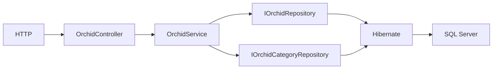

# Concept trace

POST JSON → Jackson tạo Orchid/nested category ID → Bean Validation → service transaction → find category theo ID → dùng managed category → tạo Orchid mới để bỏ qua ID client → repository.save → Hibernate INSERT → SQL Server sinh identity và enforce FK → trả201+Location cùng JSON. Category không tồn tại trả400, không INSERT Orchid.

GET search → @RequestParam name → service trim → derived query findByOrchidNameContainingIgnoreCase → Hibernate SELECT → SQL Server → entities → Jackson JSON. GET missing trả404 qua domain exception/advice.

Orchid.orchidCategory là owning side, @JoinColumn(name="category_id") giữ FK trên bảng orchids. OrchidCategory.orchids là inverse side; mappedBy="orchidCategory" là tên field Java, không phải tên cột. Collection có @JsonIgnore để serialization dừng vòng lặp. Không cascade delete category khi xóa orchid.

Orchid.orchidID giữ tên JSON theo đề; @Column(name="orchid_id") cố định SQL column để không phụ thuộc cách Hibernate tách acronym ID. Category PK là category_id. SQL Server FK: orchids.category_id → orchid_categories.category_id. Write methods @Transactional; reads readOnly. Đổi category qua PUT thay FK tới category có sẵn, không INSERT category mới.

Unit test mock repository kiểm tra orchestration; web slice kiểm tra binding/status; SQLServerIntegrationTest dùng datasource thật kiểm tra mapping/query/HTTP/DB, rollback riêng mỗi test. Newman và restart evidence kiểm tra server/JAR qua TCP thật.
